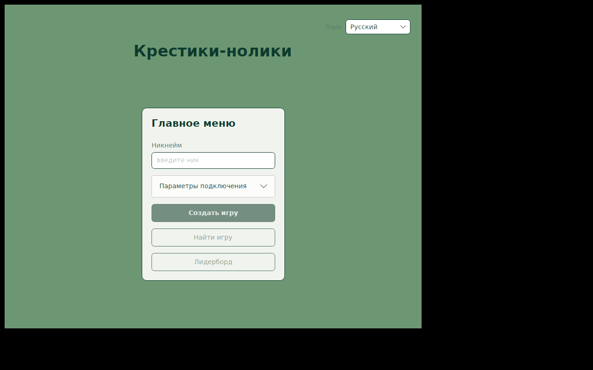
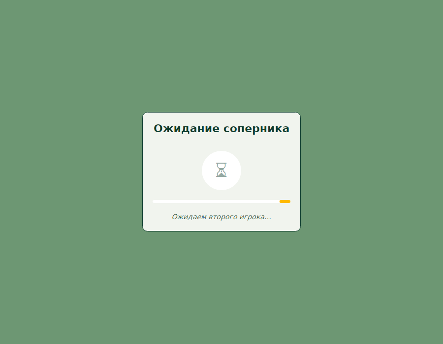
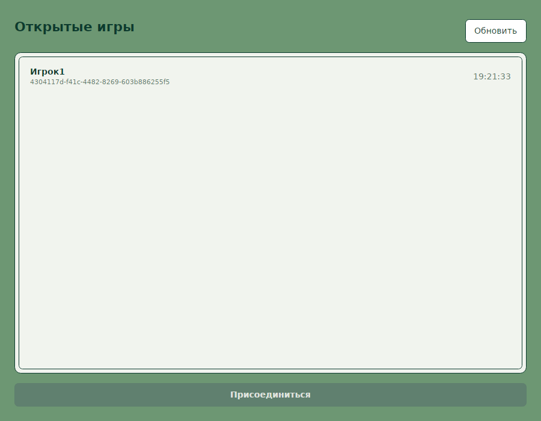
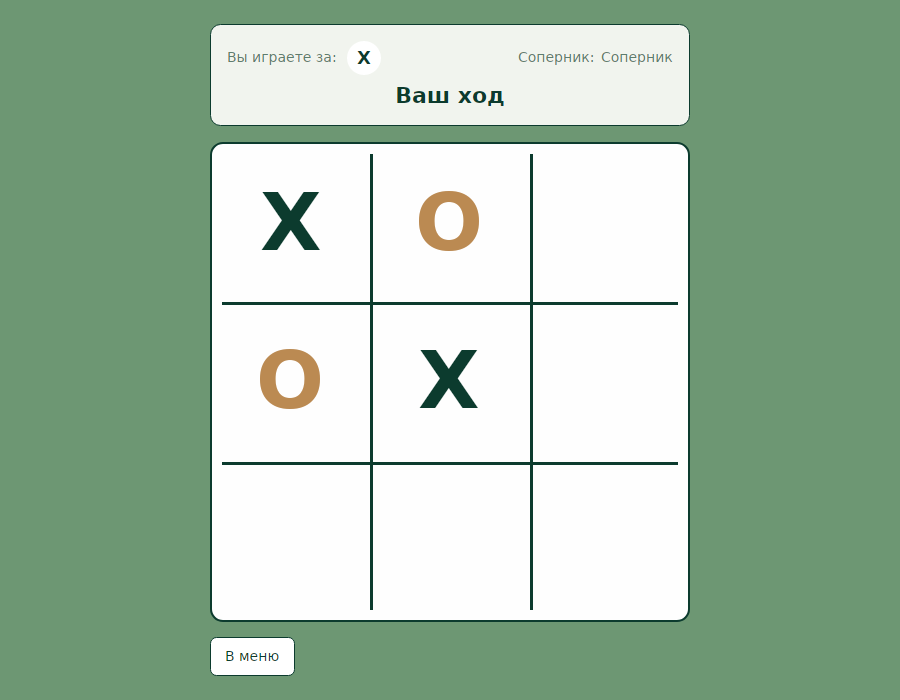
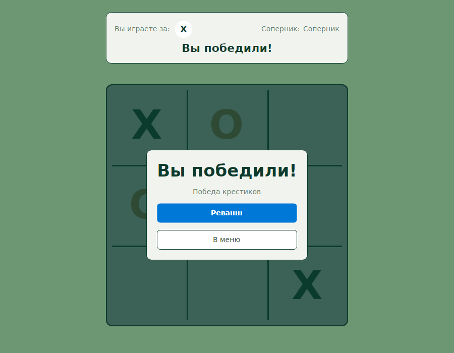

# PELab4 — Сетевые крестики-нолики

Клиент-серверная игра «Крестики-нолики» для двух игроков по сети, с лобби и таблицей рекордов.

## Краткое описание

- Сервер на TCP/JSON-протоколе, держит лобби и одновременные партии.
- Клиент на Avalonia UI (Windows, Linux, macOS), MVVM на CommunityToolkit.Mvvm.
- Таблица рекордов хранится на сервере в SQLite.
- Поддержка двух языков интерфейса: русский, английский.

## Возможности

- **Лобби** — список открытых игр в реальном времени, можно создать свою или присоединиться к чужой.
- **Игровое поле 3×3** — кликабельные клетки, плавная анимация появления символа, подсветка чьего сейчас хода.
- **Таблица рекордов** — победы / поражения / ничьи по никнеймам, отсортированы по числу побед.
- **Реванш** — после окончания партии можно сыграть ещё раз тем же составом без выхода в лобби.
- **Локализация RU / EN** — переключается прямо в главном меню без перезапуска.
- **Кастомная тёплая тема** — собственная палитра (тёплый голубой фон, бежевые/белые поверхности, оранжевый акцент), единый стиль кнопок, списков и таблицы.
- **Кроссплатформенность** — один и тот же код работает на Windows, Linux и macOS.

## Поддерживаемые платформы

- Windows 10/11 (x64)
- Linux (x64)
- macOS (x64, arm64)

Целевой фреймворк: .NET 9.

## Сборка и запуск

```bash
# Сборка решения
dotnet build PELab4.slnx

# Запуск сервера
dotnet run --project src/TicTacToe.Server

# Запуск клиента (в отдельном терминале)
dotnet run --project src/TicTacToe.Client
```

Сервер по умолчанию слушает порт `5050`. Параметры конфигурируются в
`src/TicTacToe.Server/appsettings.json` (`Server:Port`, `Server:DbPath`).

## Запуск тестов

```bash
dotnet test PELab4.slnx
```

## Структура решения

```
src/
  TicTacToe.Shared/       — POCO-модели и контракты сетевого протокола
  TicTacToe.Server/       — TCP-сервер с лобби и БД рекордов
  TicTacToe.Client.Core/  — игровая логика и ViewModel'и (без UI)
  TicTacToe.Client/       — Avalonia-приложение (View, темы, локализация)
tests/
  TicTacToe.Shared.Tests/
  TicTacToe.Server.Tests/
  TicTacToe.Client.Core.Tests/
```

## Инструкции по работе

1. **Запустите сервер** (`dotnet run --project src/TicTacToe.Server`). По умолчанию он
   слушает `0.0.0.0:5050` и создаёт файл `leaderboard.db` рядом с собой.
2. **Запустите два клиента** (на одной или разных машинах в локальной сети).
3. На каждом клиенте в **Главном меню**:
   - введите **никнейм**;
   - при необходимости откройте «Параметры подключения» и укажите адрес/порт
     сервера (по умолчанию `127.0.0.1:5050`).
4. **Игрок 1** нажимает «Создать игру» → попадает на экран ожидания.
5. **Игрок 2** нажимает «Найти игру» → видит список открытых игр →
   выбирает игру → «Присоединиться».
6. Сервер шлёт обоим клиентам `GameStarted`, открывается экран игры с полем 3×3.
   X ходит первым, дальше — по очереди.
7. По завершении партии (победа или ничья) появляется оверлей с результатом и
   двумя кнопками: «Реванш» (продолжить с теми же игроками, поле очищается)
   и «В меню».
8. **Лидерборд** доступен из главного меню — показывает топ-20 игроков по
   количеству побед.
9. **Язык интерфейса** (RU / EN) переключается в правом верхнем углу главного
   меню.

## Скриншоты

Скриншоты приложения находятся в [`docs/images/`](docs/images):

- [`main-menu.png`](docs/images/main-menu.png) — главное меню
- [`waiting.png`](docs/images/waiting.png) — ожидание соперника
- [`lobby.png`](docs/images/lobby.png) — список открытых игр
- [`game.png`](docs/images/game.png) — игровое поле
- [`game-over.png`](docs/images/game-over.png) — экран результата партии

| Меню | Ожидание | Лобби | Игра |
|---|---|---|---|
|  |  |  |  |



## Разработка

Работа ведётся в feature-ветках, изменения принимаются через Pull Request с
обязательным прохождением CI (build + tests).

Документация автоматически собирается DocFX и публикуется на GitHub Pages
([workflow](.github/workflows/docs.yml)).

Self-contained сборки клиента и сервера для `win-x64` / `linux-x64` /
`osx-x64` собираются автоматически на push в `main` и при создании тега `v*`
([workflow](.github/workflows/release.yml)).
